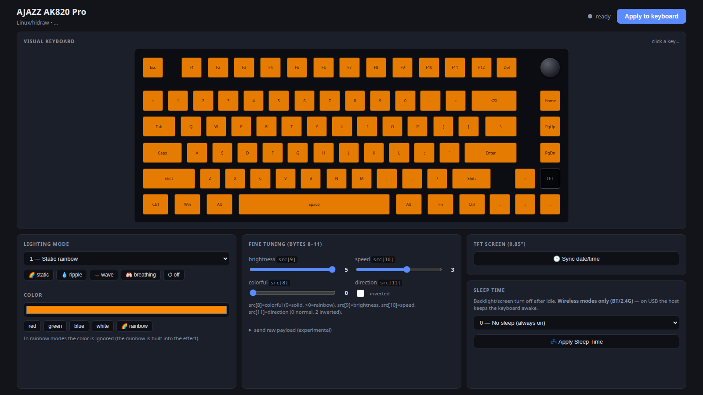

# ajazzctl

**Unofficial Linux control tool for AJAZZ tri-mode RGB keyboards** — tested on the
**AJAZZ AK820 Pro** (75%, 81 keys + knob + 0.85" TFT).

Reimplements, over Linux `hidraw`, the HID protocol used by the vendor Windows
driver: RGB lighting, TFT clock, firmware sleep timer and a local web UI with a
clickable keyboard preview.



> **Disclaimer** — This project is not affiliated with, endorsed by, or supported
> by AJAZZ / Shenzhen A-Jazz. It is an independent interoperability effort based
> on static reverse engineering of the publicly distributed Windows installer.
> "AJAZZ" and product names are trademarks of their respective owners.

---

## Features

- **RGB lighting** — all 16 firmware modes, per-mode color, brightness (0–5),
  speed (0–5), direction/inversion and the rainbow flag.
- **Visual keyboard** — AK820 Pro 75% layout drawn from a derived layout asset;
  click any key to see its `key_index`, `light_index` and HID usage code.
- **TFT clock** — syncs the on-board screen date/time with the host clock.
- **Sleep Time** — configures the firmware idle timeout (No sleep / 1 / 5 / 30 min).
- **Local web UI** — single-page dashboard, no build step, no external assets.
- **Pure standard library** — Python 3.8+, `fcntl.ioctl` only; no kernel module,
  no `pip install`, no hidapi.
- **Raw command escape hatch** — send any hex payload for protocol exploration.

## Supported hardware

| VID:PID | Device | Notes |
|---|---|---|
| `0c45:8009` | AJAZZ AK820 Pro (USB) | full support (tested) |
| `0c45:8006` | AJAZZ keyboard (USB) | lighting (protocol-compatible) |
| `0c45:fefe` | 2.4G dongle | configuration interface (MI_03) |

The keyboard is identified as Sonix Technology (`0c45`), the MCU vendor.

> **Bluetooth:** the vendor configuration protocol is **not exposed over BT HID**
> (only standard keyboard reports are carried), so lighting/clock/sleep must be
> configured over **USB or the 2.4G dongle**. Settings are stored in the keyboard
> and keep working when you switch back to Bluetooth.

## Requirements

- Linux with `hidraw` (standard since 2.6.x).
- Python 3.8 or newer.
- Root access to `/dev/hidraw*`, or the included udev rule.

## Installation

```bash
git clone https://github.com/<you>/ajazzctl.git
cd ajazzctl

# optional: allow unprivileged access (recommended)
sudo cp 99-ajazz-ak820-pro.rules /etc/udev/rules.d/
sudo udevadm control --reload
sudo udevadm trigger
```

## Quick start

```bash
./ajazz_ctl.py list            # list candidate hidraw interfaces
./ajazz_ctl.py probe           # find the interface that speaks the protocol

# lighting: mode 7 (breathing), orange, full brightness, medium speed
./ajazz_ctl.py light --mode 7 --color FF8800 --brightness 5 --speed 3

# TFT screen clock
./ajazz_ctl.py clock

# firmware sleep timeout (0=off, 1=1 min, 2=5 min, 3=30 min)
./ajazz_ctl.py sleep 2

# web UI
sudo ./ajazz_ctl.py serve      # http://127.0.0.1:8642
```

`serve` needs root unless the udev rule is installed. The server keeps the HID
session open and retries intermittent ACKs automatically.

## CLI reference

| Command | Description |
|---|---|
| `list` | list `/dev/hidraw*`, VID:PID and interface number |
| `probe` | send the `04 18` handshake and report which interface ACKs |
| `dump` | send `04 18`/`04 13` and hex-dump the feature-report responses |
| `light` | apply lighting (`--mode`, `--color RRGGBB`, `--brightness 0-5`, `--speed 0-5`, `--direction 0\|2`, `--colorful 0-5`) |
| `clock` | sync the TFT clock (`--index` selects the screen item) |
| `sleep` | set the firmware sleep timeout (`0-3`); `--fn-switch` and `--key-respond` preserve the other fields |
| `raw` | send a raw payload (`04 18`, or `--wire 00 04 18`), optionally `--ack`/`--read` |
| `serve` | start the local web UI (`--host`, `--port`) |

Every command accepts `--device /dev/hidrawN` to bypass auto-detection.

## Web UI

Start it with `sudo ./ajazz_ctl.py serve` and open <http://127.0.0.1:8642>.

| Endpoint | Method | Description |
|---|---|---|
| `/` | GET | dashboard (`static/index.html`) |
| `/api/state` | GET | current state, device, last ACK, mode tables |
| `/api/modes` | GET | lighting mode table |
| `/api/layout` | GET | keyboard layout (derived JSON) |
| `/api/light` | POST | `{mode,color,brightness,speed,direction,colorful}` |
| `/api/clock` | POST | `{index}` — sync the TFT clock |
| `/api/sleep` | POST | `{value,fn_switch,key_respond}` |
| `/raw` | POST | `{payload,ack}` — raw hex payload |

The UI previews the selected effect (solid color, rainbow gradient, brightness
and reactive modes) and lets you click a key to inspect its indices.

## How it works

The vendor "driver" is a user-mode Windows application; there is **no kernel
driver and no firmware blob**. It talks to the keyboard through 65-byte HID
feature reports:

```
wire = [00, 04, CMD, payload...]        65 bytes, report ID 0
ACK  = response[4] == 0x01              read with HIDIOCGFEATURE
```

Writing a setting follows a session sequence
(`04 18` → `04 13` → data + `AA 55` → `04 02` → `04 F0`), with command-specific
variations for the TFT clock (`04 28`) and system settings (`04 17`).

See **[PROTOCOL.md](PROTOCOL.md)** for the full command table, packet layouts,
confirmed field meanings and the 16 lighting modes.

## Project layout

```
ajazzctl/
├── ajazz_ctl.py                 # CLI + HID protocol (stdlib only)
├── server.py                    # local HTTP server + JSON API
├── static/index.html            # single-page dashboard
├── assets/ak820-pro-layout.json # derived keyboard layout (no vendor files)
├── 99-ajazz-ak820-pro.rules     # udev rule for unprivileged access
├── tools/                       # reverse-engineering scripts (optional)
├── docs/screenshot.png
├── PROTOCOL.md                  # protocol documentation
├── PLAN.md                      # roadmap / implementation notes
└── LICENSE                      # GPL-3.0-or-later
```

`temp/` (vendor installer + extracted files) is **git-ignored** and is not part
of the repository. The committed layout asset is derived data; the tool does not
need any vendor binary at runtime.

### Reproducing the reverse engineering (optional)

The scripts in `tools/` require `pefile` and `capstone`:

```bash
pip install pefile capstone
mkdir -p temp && cd temp
# extract the official Windows installer here, so that:
#   temp/driver.exe
#   temp/extracted/app/DeviceDriver.exe
cd ..
python3 tools/find_hid.py
```

## Status and roadmap

- [x] Protocol reverse engineering (transport, ACK, apply sequence)
- [x] Light packet (mode, RGB, bytes 8–11), modes 0–15 confirmed on hardware
- [x] TFT clock (`04 28`) — confirmed on hardware
- [x] Sleep Time (`04 17`) — confirmed in Bluetooth mode
- [x] Web UI with real-time lighting and visual keyboard
- [ ] TFT image/GIF upload (`04 72`, RGB565 blocks)
- [ ] Key remapping (`0x23`) and macros
- [ ] Per-key custom lighting (`0x19` / `0x15`)
- [ ] 2.4G variant of the system-settings packet
- [ ] Live key events in the UI (evdev)

## Troubleshooting

| Symptom | Fix |
|---|---|
| `Permission denied on /dev/hidraw*` | install the udev rule or run with `sudo` |
| `no ACK` / flaky ACKs | retry; ACKs are intermittent by design; try another `--device` |
| `No Sonix (0c45) device found` | connect over USB or the 2.4G dongle; BT is not configurable |
| Sleep settings seem ignored | the timeout only applies in wireless mode (BT/2.4G) |
| `address already in use` | another `serve` is running on port 8642 (`--port` to change) |

## Contributing

Issues and pull requests are welcome. Please:

- keep the tool dependency-free (standard library only);
- test changes against real hardware when possible;
- never commit vendor binaries or files extracted from the official installer;
- keep protocol findings documented in `PROTOCOL.md`.

## License

Licensed under the **GNU General Public License v3.0 or later**
(`GPL-3.0-or-later`). See [LICENSE](LICENSE).

```
Copyright (C) 2026 AJAZZ Linux contributors
```

This program is distributed in the hope that it will be useful, but **without
any warranty**; without even the implied warranty of merchantability or fitness
for a particular purpose. See the GNU General Public License for details.
